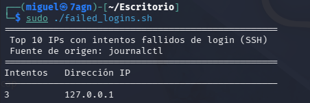

# Guion de práctica
Comandos:
```
id
```
Te dice quién eres para el sistema: tu UID, tu GID primario y todos los grupos secundarios a los que perteneces.
```
umask
```
Muestra la máscara de permisos actual.
```
ls -l /etc/passwd /etc/shadow
```
Para comprobar los permisos de un archivo, de esta manera puedes comparar entre dos rutas. Si alguna vez _/etc/shadow_ es legible por otro, es un fallo muy grave.
```
find / -perm -4000 -type f 2>/dev/null
```
Esto es una enumeración de binarios SUID:
- -perm -4000 -> El guión delante del 4000 significa "que tenga al menos el bit SUID puesto", independientemente de los permisos que tenga.
- -type f -> solo archivos.
- 2>/dev/null -> Descarta los errores de "permiso denegado" que salen al recorrer /, para que la salida quede limpia
```
ps -eo pid,ppid,user,cmd --sort=-%mem | head
```
Desglose:
- -e -> Todos los procesos
- -o pid,ppid,user,cmd -> Elegimos las columnas que queramos
- --sort=-%mem -> Ordena por memoria descendente
- head ->Nos quedamos con los 10 primeros
Podemos ver con que usuario corre cada proceso y practicamos lo del PID, PPID.
```
systemctl list-units --type=service --state=running
```
Te enseña solo los servicios que están activos ahora mismo. En este caso filtramos por tipo _service_ y estado _running_. Cada servicio de mas que este trabajando es superficie de ataque.
```
journalctl -u ssh --since "1 hour ago"
```
Lee del journal solo los logs del servicio SSH, en este caso de la última hora.
# Ejercicio propuesto
Tenemos que escribir un script llamado _failed_logins.sh_, el script tiene que hacer lo siguiente:
Tiene que leer el log de autentificacion, quedarse con las líneas de intentos fallidos de SSH, sacar la IP de cada una, contar las veces que aparece cada IP y termine mostrando las 10 más repetidas con su recuento.
La salida del programa es la siguiente:

Para obtener esta salida hemos iniciado el servidor SSH de nuestra VM de kali y hemos generado varios intentos de inicio de sesión fallidos con un usuario falso.
Hay que tener en cuenta que este script tiene la limitación de que solo sirve para IPv4, por lo tanto para generar un intento de inicio de sesión hemos usado el comando _ssh usuario_falso@127.0.0.1_ en lugar de _ssh usuario_falso@localhost_.