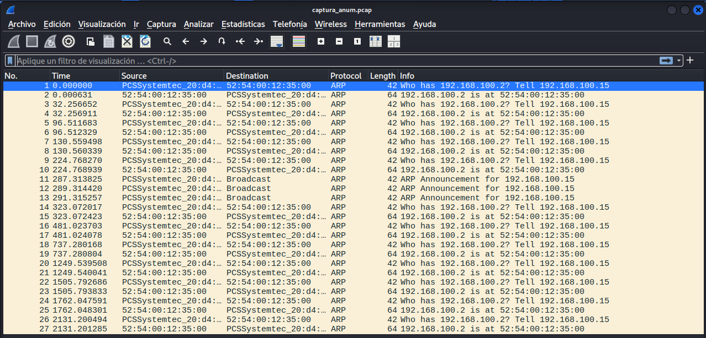
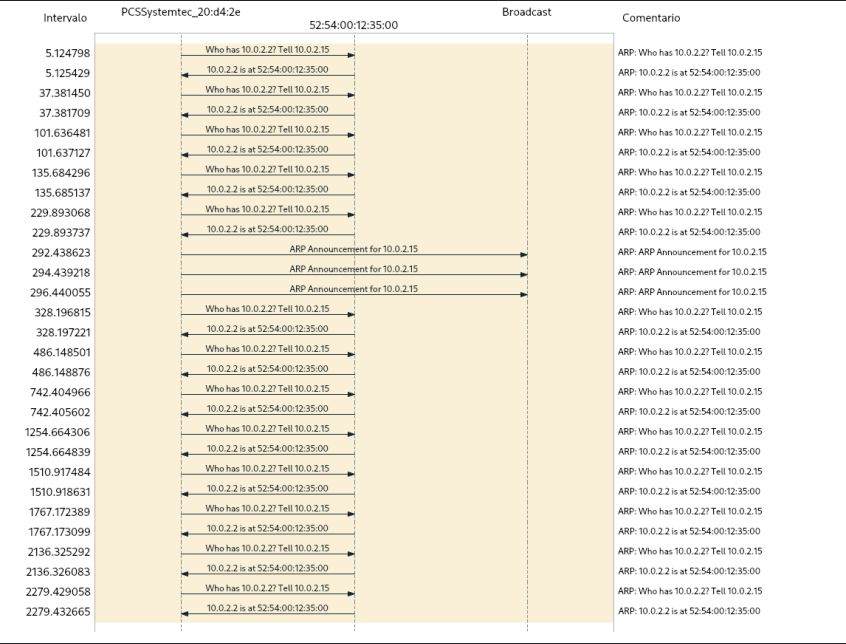

En esta práctica vamos a capturar nuestro tráfico de con tcpdump y vamos a etiquetar cada fase del proceso, vamos a realizarla en una máquina de kali.
# Práctica
Empezamos la práctica vaciando la caché ya que ARP y DNS solo aparecen si no están en caché. Tras esto comprobamos cual es nuestra interfaz y guardamos en tráfico en una captura con el comando
```
sudo tcpdump -i eth0 -w captura.pcap
```
- Con -i eth0 indicamos la interfaz que vamos a escuchar
- Con -w guardamos los paquetes en bruto en un archivo .pcap en este caso.
Ahora generamos el tráfico usando _curl_ ya que este usa TCP y nos ayuda con la realización de la práctica.
Tras todo esto podemos abrir el archivo captura.pcap que hemos generado y analizar cada fase usando los diferentes filtros:
En este caso vamos a observar el filtro ARP

En este caso observamos como se está preguntando por una IP y pidiendo que respondan a la otra, el router informa que esa dirección IP está en dicha dirección MAC, además, se obtienen los ARP announcements, donde un host anuncia su propia IP y su dirección MAC, en la siguiente imagen podemos observar el diagrama de flujo de la secuencia:

# Ejercicio propuesto
Tenemos que hacer script de python que lea un __.pcap__  con __scapy__ y mostrar una tabla con el nº del paquete, el protocolo, el origen y el destino y, en caso de ser DNS, el nombre consultado. El script se puede encontrar en el repositorio con el nombre _pcap_summary.py_.