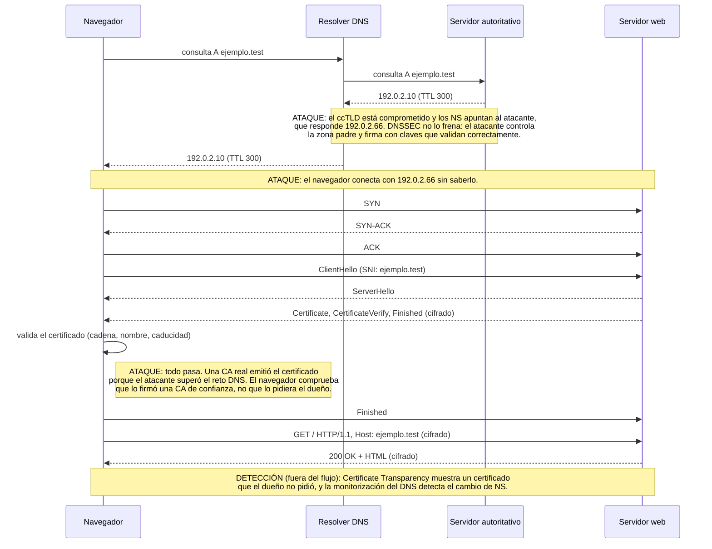

# DNS/ARP/TLS anomaly lab

Analizador de anomalías sobre eventos de red **sintéticos**: detecta una consulta DNS con aspecto de túnel o C2, un cambio de MAC en la tabla ARP (posible ARP spoofing) y un certificado TLS que no coincide con el esperado.

> Todos los datos son inventados: dominios reservados `.test` (RFC 2606), IPs del rango de documentación `192.0.2.0/24` (RFC 5737) y MAC del rango de documentación `00:00:5e:00:53:xx` (RFC 7042). No se ha capturado tráfico de ninguna red real.

## Problema

Un analista SOC no revisa paquetes uno a uno: necesita **reglas** que conviertan miles de eventos en unas pocas alertas con sentido. Este lab construye tres reglas sencillas para las anomalías más típicas de DNS, ARP y TLS, y comprueba que detectan exactamente lo sembrado **sin falsos positivos** en el tráfico normal.

También conecta con un caso real: si se compromete un ccTLD, un atacante puede obtener de una CA real un certificado válido para un dominio ajeno. El diagrama de la sección [Flujo HTTPS](#flujo-https-y-certificado-fraudulento) muestra en qué paso falla cada control.

## Estructura

| Archivo | Contenido |
|---|---|
| [`generate_synthetic.py`](generate_synthetic.py) | Genera `data/sample_events.json` con 20 eventos normales y 3 anomalías. Usa una semilla fija, así que el resultado es siempre el mismo |
| [`data/sample_events.json`](data/sample_events.json) | Eventos sintéticos y lista de certificados esperados (`expected_certs`) |
| [`analyze.py`](analyze.py) | Las tres reglas de detección y el programa principal |
| [`tests/test_analyze.py`](tests/test_analyze.py) | 6 tests con pytest: un caso positivo y uno negativo por regla, más el dataset completo |
| [`diagrams/https-flow.md`](diagrams/https-flow.md) | Diagrama de secuencia HTTPS y tabla de controles |

## Uso

```bash
python3 generate_synthetic.py                 # regenera data/sample_events.json
python3 analyze.py data/sample_events.json    # analiza los eventos
python3 -m pytest -v                          # ejecuta los tests
```

Salida esperada del análisis:

```
Eventos analizados: data/sample_events.json
Alertas detectadas: 3
[1] DNS_SUSPICIOUS_LABEL | dns-anomaly-1 | Etiqueta DNS sospechosa: 'hbrpoig8f1cbfno6b9m8'; longitud=20, entropía=3.78
[2] ARP_DUPLICADO | arp-anomaly-1 | 192.0.2.1 aparece con una MAC distinta: 00:00:5e:00:53:01 -> 00:00:5e:00:53:99
[3] TLS_CERT_FINGERPRINT_MISMATCH | tls-anomaly-1 | Huella inesperada para ejemplo.test: esperada=c2df95ae…, observada=083b8349…
```

| Código de salida | Significado |
|---|---|
| `0` | El análisis termina, haya o no alertas |
| `2` | Error de uso (falta el argumento) o de lectura (archivo inexistente, JSON inválido o falta una clave) |

## Reglas de detección

| Regla | Qué comprueba | Por qué así |
|---|---|---|
| `DNS_SUSPICIOUS_LABEL` | El primer trozo del nombre consultado tiene **≥ 20 caracteres** y una **entropía de Shannon ≥ 3,5 bits por carácter** | Los túneles DNS y los dominios generados por malware parecen aleatorios. Exigir longitud y entropía a la vez evita alertar por nombres largos pero legibles, como `servidor-de-correo-interno` |
| `ARP_DUPLICADO` | Guarda la primera MAC vista para cada IP y alerta si la misma IP aparece después con otra MAC | Es el patrón del ARP spoofing: el atacante anuncia la IP del gateway con su propia MAC. Es la misma idea que usa arpwatch |
| `TLS_CERT_FINGERPRINT_MISMATCH` | Si el `sni` está en `expected_certs` y la huella SHA-256 del certificado no coincide, alerta | Detecta un certificado distinto del legítimo aunque sea técnicamente válido. Los dominios que no están en la lista no se vigilan, para no alertar con cada web nueva |

Los umbrales están como constantes al principio de `analyze.py` (`MIN_LABEL_LENGTH`, `ENTROPY_THRESHOLD`). En los datos de prueba, el nombre normal con más entropía es `intranet` (2,5 bits) y la anomalía tiene 3,78, así que el margen es amplio.

**Sobre el origen de los eventos TLS.** En TLS 1.3 el certificado del servidor viaja cifrado y no se ve en una captura pasiva. Por eso los eventos TLS llevan `"source": "proxy"`: en un entorno real, este dato vendría de un proxy con inspección TLS, de los logs del endpoint o de la monitorización de Certificate Transparency.

## Flujo HTTPS y certificado fraudulento

Recorrido de `https://ejemplo.test` desde la consulta DNS hasta la petición HTTP cifrada. Las notas **ATAQUE** describen qué ocurre si el ccTLD está comprometido y una CA real emite un certificado al atacante. La tabla completa de controles está en [`diagrams/https-flow.md`](diagrams/https-flow.md).



## Qué observaría un analista SOC

### Alerta 1: etiqueta DNS sospechosa

- **Qué se ve:** un equipo interno consulta `hbrpoig8f1cbfno6b9m8.c2.test`. El primer trozo tiene 20 caracteres y parece aleatorio.
- **Cómo se investiga:** ¿es una consulta aislada o hay muchas al mismo dominio padre (`c2.test`) con subdominios distintos? Un goteo constante de nombres aleatorios, sobre todo de tipo TXT, apunta a un **túnel DNS** o a C2. Después se mira qué proceso del equipo hace las consultas (EDR o Sysmon, evento 22 de DNS) y la reputación y antigüedad del dominio.
- **Falsos positivos habituales:** CDNs y servicios en la nube que usan identificadores largos en sus subdominios, y algunos antivirus que consultan hashes por DNS. Se reducen con una lista de dominios conocidos.
- **Siguiente paso:** si se confirma, aislar el equipo, bloquear el dominio en el resolver y buscar las mismas consultas en el resto de la red.

### Alerta 2: cambio de MAC para el gateway

- **Qué se ve:** `192.0.2.1`, el gateway, pasa de la MAC `…:01` a la MAC `…:99`. Todo el tráfico que sale a Internet podría estar pasando por el equipo con la MAC nueva.
- **Cómo se investiga:** ¿a qué puerto del switch está conectada la MAC `…:99`? ¿Hay un cambio planificado o un failover de router (VRRP o HSRP)? ¿Aparecen ráfagas de ARP gratuitos? Si la MAC nueva es la de un equipo de usuario, es casi seguro un ataque.
- **Falsos positivos habituales:** failover de routers, cambio de tarjeta de red, IPs de DHCP reasignadas y máquinas virtuales que migran.
- **Siguiente paso:** desconectar el puerto del atacante, limpiar las cachés ARP afectadas y, si las víctimas usaron protocolos sin cifrar, dar por expuestas sus credenciales. Prevención: Dynamic ARP Inspection en los switches.
- **Limitación:** ARP no sale de la red local, así que el sensor tiene que estar en ese segmento.

### Alerta 3: certificado inesperado para un dominio vigilado

- **Qué se ve:** una conexión a `ejemplo.test` presenta un certificado cuya huella no es la del legítimo.
- **Cómo se investiga:** ¿quién emitió el certificado nuevo y cuándo? Se busca en los logs de Certificate Transparency (por ejemplo, en crt.sh). Si es de una CA conocida y no lo pidió la organización, se revisa el DNS del dominio: cambios de NS o de registros A, y posibles retos ACME. ¿Hubo una renovación legítima que no se actualizó en la lista?
- **Falsos positivos habituales:** renovaciones de certificado (la huella cambia en cada renovación) y CDNs que sirven certificados distintos según la región.
- **Siguiente paso:** si es fraudulento, pedir la revocación a la CA, recuperar el control del DNS y avisar a los usuarios que pudieron conectarse al servidor falso.

### Qué no se ve en estos datos

- **TLS 1.3 cifra el certificado.** Con solo una captura pasiva, el analista ve el SNI pero no el certificado. La alerta 3 necesita inspección TLS, logs del endpoint o monitorización de CT.
- **NAT oculta el origen real.** Si los eventos se recogieran después del NAT, todos los equipos internos aparecerían con la misma IP pública. Para saber qué equipo hizo la consulta se necesitan los logs de NAT con la hora exacta y el puerto de origen.

## Técnicas MITRE ATT&CK

Técnicas comprobadas en ATT&CK v20.

| Anomalía | Técnica | Táctica | Mitigaciones de ATT&CK relevantes |
|---|---|---|---|
| ARP duplicado | [T1557.002 Adversary-in-the-Middle: ARP Cache Poisoning](https://attack.mitre.org/techniques/T1557/002/) | Credential Access, Collection | M1037 Filter Network Traffic, M1031 Network Intrusion Prevention, M1041 Encrypt Sensitive Information |
| DNS sospechoso | [T1071.004 Application Layer Protocol: DNS](https://attack.mitre.org/techniques/T1071/004/) | Command and Control | M1037 Filter Network Traffic, M1031 Network Intrusion Prevention |
| Certificado fraudulento emitido por una CA | [T1588.004 Obtain Capabilities: Digital Certificates](https://attack.mitre.org/techniques/T1588/004/) | Resource Development | Fuera del alcance del defensor; se detecta con Certificate Transparency |
| Certificado autofirmado del atacante | [T1587.003 Develop Capabilities: Digital Certificates](https://attack.mitre.org/techniques/T1587/003/) | Resource Development | Fuera del alcance del defensor; el navegador lo rechaza si no está en el almacén de confianza |

**Nota sobre los certificados.** T1587.003 es cuando el atacante **crea** su propio certificado, normalmente autofirmado. El caso del ccTLD comprometido es distinto: el atacante **consigue** que una CA real se lo emita, y eso encaja con T1588.004. Las dos técnicas pertenecen a Resource Development, una fase previa al ataque que ocurre fuera de la red de la víctima. Por eso no hay mitigaciones directas: el defensor solo puede detectar su uso.

## Qué he aprendido

<!-- Completar con tus palabras. Ideas de lo que salió en el lab:
- Que TCP y TLS son dos handshakes distintos en capas distintas, y el orden DNS → TCP → TLS → HTTP.
- Que con un certificado fraudulento ninguna flecha del protocolo falla: el navegador confía en algo que el atacante controla.
- Por qué en TLS 1.3 no se ve el certificado en una captura pasiva.
- El fallo silencioso: al renombrar campos del JSON, la regla TLS dejó de detectar sin dar ningún error, y fue un test el que lo cazó.
- La entropía de Shannon como forma de medir si un texto "parece aleatorio".
- Rutas con Path(__file__) para que los tests funcionen desde cualquier carpeta.
- Diferenciar una anomalía detectada de un ataque confirmado
- Desarrollar reglas de detección en Python

## Posibles mejoras

- Leer capturas .pcap reales de laboratorio con scapy en vez de JSON.
- Usar el TTL en la regla DNS y detectar volumen anómalo de consultas por dominio padre.
- Detectar ráfagas de ARP gratuitos, no solo cambios de MAC.
- Exportar las alertas en JSON para enviarlas a un SIEM.
- Cargar expected_certs desde un archivo de configuración aparte.
- Añadir niveles de severidad y puntuación de riesgo
- Incorporar fechas y ventanas temporales para correlacionar eventos

## Referencias

- [RFC 8446 – TLS 1.3](https://www.rfc-editor.org/rfc/rfc8446)
- [RFC 1034](https://www.rfc-editor.org/rfc/rfc1034) y [RFC 1035](https://www.rfc-editor.org/rfc/rfc1035) – DNS
- [RFC 6962 – Certificate Transparency](https://www.rfc-editor.org/rfc/rfc6962)
- [RFC 5737](https://www.rfc-editor.org/rfc/rfc5737), [RFC 2606](https://www.rfc-editor.org/rfc/rfc2606) y [RFC 7042](https://www.rfc-editor.org/rfc/rfc7042) – rangos y nombres de documentación
- [Documentación de Wireshark](https://www.wireshark.org/docs/)
- [MITRE ATT&CK – Enterprise](https://attack.mitre.org/tactics/enterprise/)
