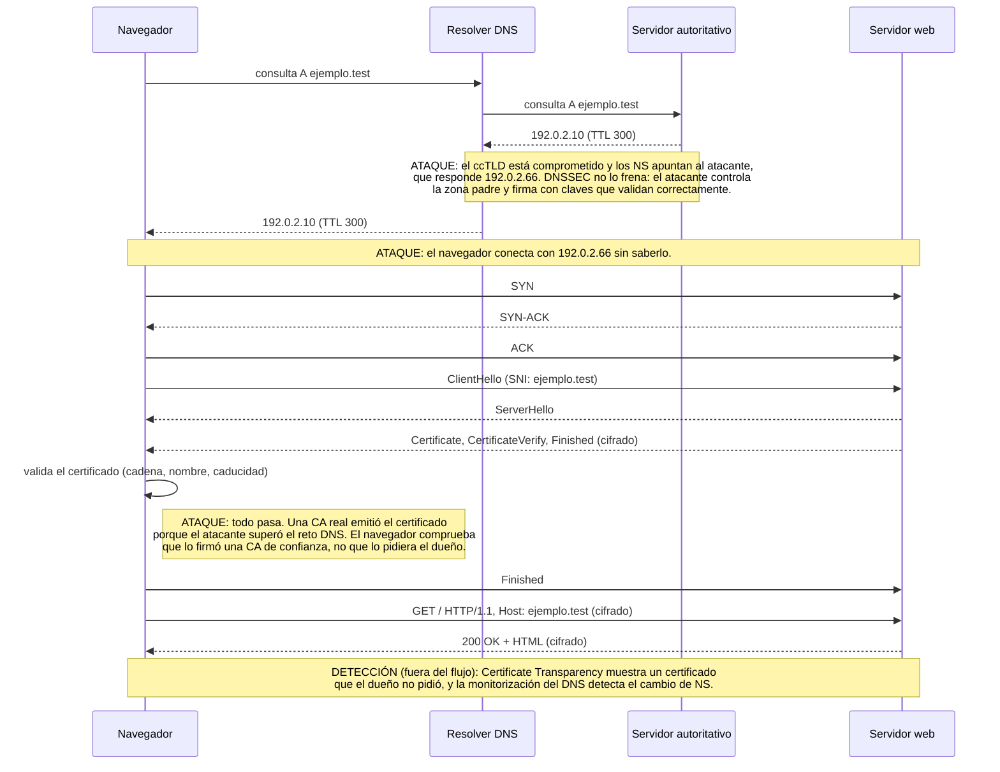

# Flujo HTTPS de `https://ejemplo.test` y certificado fraudulento

Diagrama de secuencia de una petición HTTPS: resolución DNS, handshake TCP, handshake TLS 1.3 y petición HTTP cifrada.

Las notas marcadas como **ATAQUE** describen qué ocurre si el ccTLD está comprometido y una CA real emite un certificado al atacante. La nota **DETECCIÓN** indica qué controles, fuera del flujo, pueden descubrirlo.

> Datos sintéticos: dominio reservado `.test` (RFC 2606) e IPs del rango de documentación 192.0.2.0/24 (RFC 5737).

## Qué control falla en cada paso

| Paso | Control | ¿Frena el ataque? | Motivo |
|---|---|---|---|
| Respuesta DNS | DNSSEC | No | El atacante controla la zona padre y firma con claves válidas |
| Emisión del certificado | CAA | No | El atacante controla el DNS y puede cambiar o borrar el registro CAA |
| Validación del certificado | Cadena de confianza | No | El certificado lo emitió una CA real; la cadena, el nombre y la fecha son correctos |
| Conexión HTTPS | HSTS | No | Obliga a usar HTTPS, pero el certificado es válido |
| Fuera del flujo | Certificate Transparency | **Detecta** | El certificado aparece en logs públicos y el dueño puede verlo |
| Fuera del flujo | Monitorización del DNS propio | **Detecta** | Alerta del cambio de NS o de la IP |
| Apps propias | Pinning | **Sí** | La app solo acepta la clave o la CA esperada |
