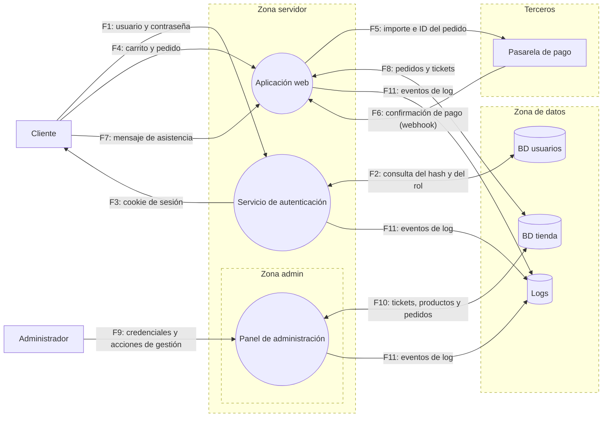

# Threat model: tienda online ficticia

> Modelo de amenazas teórico sobre una aplicación inventada. No se ha analizado ningún sistema real.

## 1. Descripción del sistema

Tienda online pequeña con catálogo, carrito, login, pago mediante una pasarela externa, formulario de asistencia y panel de administración.

| Tipo | ID | Elemento | Descripción |
|---|---|---|---|
| Entidad externa | E1 | Cliente | Usuario que compra desde su navegador |
| Entidad externa | E2 | Administrador | Gestiona productos, pedidos y tickets |
| Entidad externa | E3 | Pasarela de pago | Tercero que cobra al cliente y confirma el pago |
| Proceso | P1 | Aplicación web | Catálogo, carrito y formulario de asistencia |
| Proceso | P2 | Servicio de autenticación | Login y sesiones |
| Proceso | P3 | Panel de administración | Gestión de productos, pedidos y tickets |
| Almacén | D1 | BD de usuarios | Credenciales (hashes) y roles |
| Almacén | D2 | BD de la tienda | Productos, pedidos y tickets de soporte |
| Almacén | D3 | Logs | Registro de eventos |

Decisión de diseño: **los datos de la tarjeta nunca pasan por el servidor**. El cliente paga en la página de la pasarela y la aplicación solo recibe la confirmación.

## 2. Diagrama de flujo de datos (DFD)

Las fronteras de confianza son los bordes discontinuos de cada zona. Lo que queda fuera de cualquier zona es Internet.

### Flujos de datos

| ID | Origen → destino | Datos |
|---|---|---|
| F1 | E1 → P2 | Usuario y contraseña |
| F2 | P2 ↔ D1 | Consulta del hash y del rol |
| F3 | P2 → E1 | Cookie de sesión |
| F4 | E1 → P1 | Carrito y pedido (productos, cantidades) |
| F5 | P1 → E3 | Importe e ID del pedido (redirección al pago) |
| F6 | E3 → P1 | Confirmación de pago (webhook) |
| F7 | E1 → P1 | Mensaje de asistencia |
| F8 | P1 ↔ D2 | Pedidos y tickets |
| F9 | E2 → P3 | Credenciales y acciones de gestión |
| F10 | P3 ↔ D2 | Lectura de tickets, gestión de productos y pedidos |
| F11 | P1, P2, P3 → D3 | Eventos de log |

### Fronteras de confianza

| Frontera | Separa | Flujos que la cruzan | Motivo |
|---|---|---|---|
| TB1 | Internet ↔ Zona servidor | F1, F3, F4, F7, F9 | Todo lo que llega del navegador lo controla el atacante |
| TB2 | Zona servidor ↔ Zona de datos | F2, F8, F10, F11 | La BD solo debe aceptar conexiones de la aplicación; limita el daño si la app cae |
| TB3 | Zona servidor ↔ Terceros | F5, F6 | La pasarela es un tercero y su webhook llega desde Internet |
| TB4 | Zona servidor ↔ Zona admin | F9, F10 | Datos escritos por clientes (tickets) llegan a la zona más privilegiada |

## 3. Amenazas (STRIDE por elemento)

| ID | Elemento o flujo | STRIDE | Amenaza | Frontera |
|---|---|---|---|---|
| A1 | F4 | T | Un cliente malicioso intercepta su petición del carrito y cambia el precio o pone una cantidad negativa para pagar menos de lo que debe | TB1 |
| A2 | E2 → P3 (F9) | S | Un atacante obtiene las credenciales del admin (fuerza bruta, phishing o contraseñas reutilizadas) y entra en P3 haciéndose pasar por E2 | TB1, TB4 |
| A3 | E3 → P1 (F6) | S | Un atacante envía a P1 un webhook falso haciéndose pasar por la pasarela para que un pedido no pagado quede como pagado | TB3 |
| A4 | D3 (vía P3) | R | Un admin malicioso, o un atacante con su cuenta, borra pedidos y después elimina las entradas de log para que nadie pueda demostrar quién lo hizo | TB2 |
| A5 | P2 → D1 (F1, F2) | I | Un atacante mete una inyección SQL en el formulario de login para volcar la tabla de usuarios de D1 con hashes y roles | TB1, TB2 |
| A6 | P1, P2 (F1, F4) | D | Un atacante lanza miles de peticiones automatizadas contra el login y el carrito para saturar P1 y P2 y que los clientes no puedan comprar | TB1 |
| A7 | F7 → D2 → F10 → P3 | E | Un cliente escribe un mensaje de asistencia con JavaScript malicioso que se ejecuta en el navegador del admin al leerlo en P3 y le roba la sesión (XSS almacenado) | TB1, TB4 |
| A8 | P1 (antes de F5) | I | Un atacante modifica el JavaScript que sirve P1 e inserta un skimmer que captura los datos de tarjeta antes de redirigir a la pasarela (tipo Magecart) | TB1, TB3 |

### Cobertura de STRIDE

| Categoría | Amenazas |
|---|---|
| S · Spoofing | A2, A3 |
| T · Tampering | A1 |
| R · Repudiation | A4 |
| I · Information disclosure | A5, A8 |
| D · Denial of service | A6 |
| E · Elevation of privilege | A7 |

Las seis categorías están cubiertas. A7 y A8 combinan categorías: en A7 una manipulación (T) lleva a una elevación de privilegios (E), y en A8 una manipulación del código (T) lleva a una revelación de datos (I). Se han clasificado por **lo que consigue el atacante al final**.

## 4. Mapeo a MITRE ATT&CK y mitigaciones

Técnicas comprobadas en ATT&CK v20.

| ID | STRIDE | Técnica ATT&CK | Táctica | Mitigación |
|---|---|---|---|---|
| A1 | T | T1565 Data Manipulation | Impact | Recalcular el precio en el servidor desde D2; el cliente solo envía ID de producto y cantidad; validar cantidad > 0 y ≤ stock |
| A2 | S | T1110 Brute Force | Credential Access | M1032 Multi-factor Authentication; M1036 Account Use Policies (bloqueo tras intentos fallidos); rate limiting en el login |
| A3 | S | T1190 Exploit Public-Facing Application | Initial Access | Verificar la firma HMAC del webhook con un secreto compartido; rechazar mensajes antiguos (timestamp); confirmar el pago consultando a la pasarela por su API |
| A4 | R | T1070 Indicator Removal | Stealth | M1029 Remote Data Storage (logs en un almacén externo de solo escritura); M1022 Restrict File and Directory Permissions (P3 sin permiso de escritura en D3) |
| A5 | I | T1190 Exploit Public-Facing Application | Initial Access | Consultas parametrizadas; cuenta de BD con mínimo privilegio; hashes lentos (Argon2 o bcrypt) para limitar el impacto |
| A6 | D | T1499.003 Endpoint Denial of Service: Application Exhaustion Flood | Impact | M1037 Filter Network Traffic (CDN o servicio anti-DDoS); rate limiting por IP y por cuenta; CAPTCHA tras varios intentos |
| A7 | E | T1539 Steal Web Session Cookie | Credential Access | Codificar la salida y sanear el HTML de los tickets; Content Security Policy; cookies HttpOnly y SameSite; M1054 Software Configuration (sesiones de admin cortas) |
| A8 | I | T1056.003 Input Capture: Web Portal Capture | Collection, Credential Access | Subresource Integrity en scripts externos; CSP que limite el origen de los scripts; monitorizar cambios en los archivos JS servidos; M1026 Privileged Account Management |

### Notas sobre el mapeo

- **STRIDE y ATT&CK no son equivalentes.** STRIDE parte del diseño (qué puede fallar) y ATT&CK del comportamiento observado de atacantes reales, así que el mapeo no es 1:1.
- **A1** es un fallo de lógica de negocio. ATT&CK no recoge bien este tipo de fallos y T1565 es la técnica más cercana.
- **A3** no explota una vulnerabilidad clásica, sino la falta de verificación en un endpoint expuesto a Internet. Por eso se mapea a T1190.
- **A4 (repudio)** es la categoría que peor encaja, porque describe una carencia del sistema (no hay logs fiables) y no una acción del atacante. T1070 es lo más cercano: el atacante borra sus huellas.
- **Las mitigaciones de ATT&CK son genéricas.** Cada una se ha comprobado contra la amenaza concreta. Por ejemplo, el cifrado (M1041) no sirve en A1, porque el atacante es el propio cliente editando su petición antes de que se cifre.

## 5. Priorización

Orden propuesto según probabilidad e impacto:

1. **A5 (SQLi en login)** y **A7 (XSS a admin)**: muy probables, porque se buscan de forma automatizada, y con impacto alto (todos los usuarios o control del panel).
2. **A3 (webhook falso)** y **A1 (precio manipulado)**: pérdida económica directa y fáciles de explotar si no se valida en servidor.
3. **A2 (suplantación del admin)** y **A8 (skimmer)**: impacto muy alto, pero requieren más esfuerzo del atacante.
4. **A6 (DoS)** y **A4 (borrado de logs)**: el DoS se mitiga en gran parte con servicios externos; el borrado de logs requiere acceso previo.
